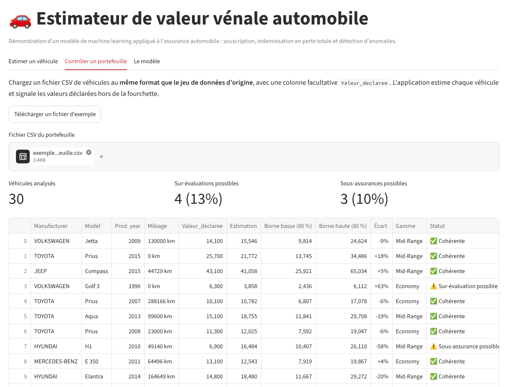

# Prédiction du prix des voitures d'occasion

Projet de data science réalisé en équipe (juin 2025), suivant la méthodologie **CRISP-DM** : compréhension des données, préparation, modélisation, évaluation et déploiement.

## 🚗 Application : estimateur de valeur vénale pour l'assurance automobile

Le modèle est mis en pratique dans une **application Streamlit** qui répond à trois besoins d'un assureur auto :

| Besoin | Ce que fait l'application |
|---|---|
| **Souscription** | estime la valeur vénale d'un véhicule et vérifie que la valeur déclarée par l'assuré est cohérente avec le marché |
| **Sinistre en perte totale** | donne une valeur de référence, avec une fourchette, pour l'indemnisation après un vol ou un accident grave |
| **Contrôle de portefeuille** | estime toute une flotte à partir d'un fichier CSV et signale les **sur-évaluations** (risque de sur-assurance ou de fraude) et les **sous-assurances** possibles |

🔗 **Application en ligne :** https://valeur-venale-auto.streamlit.app



**Modèle de l'application** (`src/train.py`)

- Cible : **logarithme du prix**, pour limiter l'influence des véhicules très chers.
- Annonces aberrantes exclues (prix inférieurs à 500 $ ou supérieurs à 250 000 $, doublons) : 17 205 annonces retenues sur 19 237.
- Choix entre forêt aléatoire et XGBoost par **validation croisée à 5 plis**, sur l'erreur absolue moyenne en dollars : la **forêt aléatoire** est retenue.
- **Fourchette à 80 %** obtenue par calibration conforme sur un échantillon séparé.

Résultats sur un échantillon de test jamais vu (20 % des données) :

| Indicateur | Valeur |
|---|---|
| R² (log du prix) | 0,74 |
| Erreur absolue moyenne | 4 854 $ |
| Erreur relative médiane | 18 % |
| Part des vrais prix dans la fourchette à 80 % | 78 % |

Les variables les plus influentes sont le nombre d'airbags (indicateur du niveau d'équipement), l'année, le kilométrage et la boîte de vitesses.

**Limites.** Les prix proviennent d'annonces d'un marché étranger, en dollars. L'application illustre une méthode, à réentraîner sur des données locales (Côte d'Ivoire, zone CIMA) pour un usage réel. Un prix d'annonce n'est pas une valeur à dire d'expert, et l'état du véhicule n'est pas observé.

**Lancer l'application en local**

```bash
pip install -r requirements.txt
# Réentraîner le modèle (facultatif, le modèle entraîné est fourni dans model/)
python src/train.py data/car_price_prediction.csv
streamlit run app.py
```

Un fichier d'exemple `data/exemple_portefeuille.csv` (30 véhicules, dont 7 valeurs déclarées volontairement faussées) permet de tester le contrôle de portefeuille.

---

## Étude initiale (notebook)

**Objectifs**
- **Régression** : prédire le prix d'un véhicule d'occasion à partir de ses caractéristiques (constructeur, année, kilométrage, moteur, carburant, boîte de vitesses, etc.).
- **Classification** : classer chaque véhicule dans une gamme de prix : *Economy* (< 15 000 $), *Mid-Range* (15 000–50 000 $) ou *Luxury* (≥ 50 000 $).

## Démarche

1. **Nettoyage** : conversion des variables mal typées (`Levy`, `Mileage`, `Engine volume`, `Doors`), suppression des doublons, repérage des valeurs aberrantes par la méthode IQR (signalées plutôt que supprimées, pour conserver les véhicules de luxe).
2. **Traitement des valeurs manquantes de `Levy`** : comparaison de plusieurs stratégies (médiane, moyenne, zéro), puis imputation KNN dans la version finale, en excluant le prix pour éviter toute fuite de la cible.
3. **Ingénierie de variables** : âge du véhicule, kilométrage par année, ratio volume moteur / cylindres, regroupement des constructeurs peu fréquents.
4. **Modélisation** : régression linéaire, Lasso et Ridge comme références, puis Random Forest et XGBoost, dans des pipelines scikit-learn (`ColumnTransformer`, `OneHotEncoder`, `StandardScaler`), avec validation croisée et optimisation des hyperparamètres (`GridSearchCV`).

## Résultats (jeu de test)

| Tâche | Modèle | Résultat |
|---|---|---|
| Régression linéaire de référence | Régression linéaire | R² ≈ 0,21 en validation croisée |
| Régression du prix | Random Forest | **R² = 0,69**, RMSE ≈ 9 963 $ |
| Classification par gamme de prix | Random Forest | **Exactitude ≈ 81 %**, F1 pondéré ≈ 0,81 |

Les modèles linéaires expliquent mal le prix : les relations sont fortement non linéaires et la distribution des prix est très asymétrique. Les méthodes d'ensemble (forêts aléatoires) améliorent nettement les performances.

## Contenu du dépôt

```
app.py                                     # application Streamlit
src/preprocessing.py                       # nettoyage des données et variables du modèle
src/train.py                               # entraînement, validation croisée et fourchette à 80 %
model/                                     # modèle entraîné et métadonnées (performances, importance)
notebooks/prediction_prix_voitures.ipynb   # étude initiale complète (avec les sorties)
data/exemple_portefeuille.csv              # portefeuille d'exemple pour l'application
data/                                      # emplacement du jeu de données complet (non inclus)
requirements.txt
```

## Reproduire l'étude initiale

1. Télécharger le jeu de données **Car Price Prediction Challenge** (`car_price_prediction.csv`, disponible sur Kaggle) et le placer dans `data/`.
2. Installer les dépendances : `pip install -r requirements.txt matplotlib seaborn jupyter`
3. Ouvrir le notebook depuis le dossier `notebooks/` : `jupyter notebook notebooks/prediction_prix_voitures.ipynb`

## Équipe

- Soro Onansongui Elixir
- Ouedraogo Makemissa Mignantcho
- Badolo A.
- Angoran A.

## Outils

Python · pandas · NumPy · scikit-learn · XGBoost · Streamlit · Matplotlib · Seaborn · Jupyter
